# 数学题库工作台

沪科版七年级上 · **22,898 道题**（原始 `E:\OCR\00001.docx … 22898.docx`，只读）。
组卷 → 打印 → 答题卡 → 拍照判卷 → 错题训练，全部在本机跑，不上传题库。

> 判卷范围：选择题（认选项序号）+ 填空题 / 解答题（认最终答案）。解答过程不判。

---

## 安装

| 项目 | 要求 |
|---|---|
| 系统 | Windows 10 / 11（需要 Word 才能把卷面转成 PDF） |
| Python | 3.11 或更新（本机实测 3.14.2） |
| Word | 建议装 Microsoft Word 2016 或更新；不装也能组卷，但公式与排版可能失真 |

```bat
cd /d <你把程序放到的目录>\app
python -m pip install -r requirements.txt
```

**放在哪个目录都能跑**（不再绑死 `E:\OCR`）。题库（原始 `*.docx`）按下面的顺序找：

1. 环境变量 `MATH_APP_QBDIR`（或旧名 `MATH_QB_ROOT`）
2. `config.json` 的 `paths.qbank`
3. `<程序目录>/qbank/`
4. 老机器兜底：`E:\OCR`（这个目录存在时才会用）

最省事的做法：把 22,898 份 docx 放进 `app\qbank\`，或者把 `config.json` 改成
`{"paths": {"qbank": "D:/题库"}}`。`data/`、`out/` 同理（默认就在程序目录下，也可用
`MATH_APP_DATA` / `MATH_APP_OUT` 或 `config.paths` 改）。

- 原始题库 **只读**，程序不会修改、移动、删除它们。
- 产物默认写 `app\data`（数据库）与 `app\out`（卷子、答题卡、判卷裁切图）。

## 启动

**双击 `start.bat`** 就行。它会依次：找 Python → 查依赖（缺了会问你要不要自动装）→ 探 Word 路径 →
起服务 `python -m uvicorn server:app --host 127.0.0.1 --port 8710` → 3 秒后自动打开浏览器。
窗口别关，关掉窗口就等于停止服务。

命令行等价写法（必须在 `app` 目录下，否则 `server:app` 找不到模块）：

```bat
cd /d E:\OCR\app
python -m uvicorn server:app --host 127.0.0.1 --port 8710
```

- 界面：<http://127.0.0.1:8710/>
- 自检页：<http://127.0.0.1:8710/health>（机器可读版 `/healthz`，JSON）
- 端口 8710 被占用时，先关掉旧的黑色窗口；要换端口就改 `start.bat` 里的 `--port` 与界面地址，并同步 `config.json`
- 想让手机拍答题卡：双击 `start_lan.bat`（LAN 模式，带 4 位访问码），详见下面「手机拍照判卷（局域网）」
- 三种环境降级实测（端口占用 / Word 缺失 / 数据库缺失）见 [`docs/DEGRADED.md`](docs/DEGRADED.md)：
  端口被占 → 窗口退出时提示原因；没 Word → 卷面标「PDF 未生成」但答题卡照常出；没库 → 首页 503 并给建库命令

## 设置（自己填 API Key / 换识别后端）

打开 **设置**（<http://127.0.0.1:8710/settings>，导航里也有），可以：

- **换识别后端**：`PaddleOCR-VL 云端` / `视觉模型（OpenAI 兼容）` / `本机离线（Windows OCR）` / `全人工确认`；
- **自己填 Key**：PaddleOCR-VL 填 token（含 model、job_url），视觉模型填 base_url + key + 模型名；
  **页面上只显示「已配置 · 尾号 abcd」**，输入框留空 = 不修改，点「清除」才删；
- **测试连接**：用内置小图（`12 x 3 = 36`）真跑一次识别，显示结果 / 耗时 / 错误码，最多等 30 秒；
- 保存会**只改 `config.json` 的 `ocr` 段**，其它键（server / paths / 备注）原样保留，并先备份 `config.json.bak`；
- 改完**立刻生效**，不用重启。注意：如果设了 `OCR_BACKEND` / `OCR_TOKEN` / `OCR_KEY` 环境变量，
  它们的优先级高于 config.json，页面会提示你。

没有 Key 也能用：把后端选成「全人工确认」，填空/解答全部进待确认队列，选择题仍走 OMR 自动判。

## 手机拍照判卷（局域网）

想让手机直接拍答题卡上传，不用先把照片传到电脑：

1. **电脑上双击 `start_lan.bat`**（等价于 `start.bat lan`）—— 它把服务开到 `0.0.0.0`，
   启动窗口会打印两个地址：
   -
   ```text
   本机：  http://127.0.0.1:8710/
   局域网：http://192.168.x.x:8710/     ← 手机用这个
   ```
2. **手机连同一个 WiFi**，扫**组卷首页顶部的二维码**（二维码里已经带上访问码，扫完一次就通），
   或者手动在手机浏览器里输上面那个局域网地址。
3. **访问码（PIN）**：LAN 模式第一次启动会自动生成 **4 位数字**，写在启动窗口里，同时存进
   `config.json` 的 `server.pin`。手机第一次访问时要输一次，之后记 30 天。
   - 电脑本机 `127.0.0.1` **不需要**访问码，自己用不受影响。
   - 没通过访问码的设备只会看到一个输入框，看不到任何卷子、答案或题库内容。
4. **防火墙**：第一次监听时 Windows 可能弹窗，勾选「专用网络」再点「允许访问」。
   没弹窗（或以管理员身份）就手动放行一次：

   ```bat
   netsh advfirewall firewall add rule name="数学题库8710" dir=in action=allow protocol=TCP localport=8710
   ```

5. **只在自己家的 WiFi 上开**。公用 WiFi / 学校网络里别开 LAN 模式——同一网络里的设备都能访问这套服务，
   访问码只是最低限度的一道门。
6. 手机端体验：判卷页对手机是竖屏自适应的，拍完直接上传；**多人同时组卷会排队**
   （Word 排版是单线程串行的，每组约 10~40 秒），按钮旁已提示，不是卡死。

> 想回到「只有本机能用」：关掉窗口，双击 `start.bat`（默认 `127.0.0.1`，不需要访问码）。

## 组卷怎么用

1. 填**试卷标题**（会印在卷面与答题卡上）和 **seed**；
2. 填**题量**：选择 / 填空 / 解答各几道，`0` = 这类不放；输入框下面会显示「可出 N 题」（按你当前勾的范围实时算），改完勾选点一下「刷新可出题量」；
3. 选**范围**：勾一个章节 = 勾上该章全部知识点；也可以逐条勾知识点；**都不勾 = 全库不限**；
   「组题口径」选「命中任一」或「必须同时命中」（复合知识点用后者）；
4. 「只选有答案题」默认开着 —— 判卷必须有标准答案，关掉会出现判不了的题；
   空题（原始 docx 里题干为空）已固定排除，不需要也不允许选；
5. **省纸模式**（默认勾上，`layout=compact`）：页边距与行距收紧，10 题 1 页 / 24 题 3 页；
   取消勾选就是宽裕版面（`layout=normal`）。省纸只改排版密度，**不改打印要求**（仍是 A4、100%）。
   所选版面会写进 `papers.params_json`，预览页「版面」一行能看到当时用的是哪种；
6. 生成后先**预览**卷面和答题卡，确认页数无误（预览页顶部会写「共 N 页（卷面 a 页 + 答题卡 b 页）」）再打印。

关于 **seed（随机种子）**：**留空就行** —— 每份卷自动换一个（表单显示「自动（每份卷不同）」），
免得你以为题库就这么点题；填一个数字则完全可复现（想再印一份一模一样的卷时用，
预览页会把这次实际用的种子显示出来，照抄即可）。

## 打印要求

- **A4 纸、100% 比例**：打印对话框里选「实际大小 / Actual size」。
- **不要勾选「适应页面」「缩放以适合纸张」「Fit to page」**。
  一旦缩放，答题卡上的选项框、四角黑块、卷号二维码的坐标就全部对不上，判卷会失败或判错。
- 黑白激光打印完全够用（黑块和二维码的对比度足够）。
- 卷面与答题卡已经按「卷面在前、答题卡在后」合并成一个 PDF（`/print.pdf`），一次打印即可，
  不用分开印两份。
- 打印后**别折叠、别压皱答题卡四角**，也别裁掉页边 —— 四角黑块是判卷定位用的。
- 纸面若受潮起皱，拍照时阴影会变重，尽量压平。

## 拍照要求

拍得好不好，直接决定判卷成不成功。按下面做，成功率最高：

- 手机**横屏、竖屏都行**，但**一次只拍一页**答题卡（别把两页拍进一张）。
- **答题卡四个角的黑色方块（ArUco 定位块）必须全部拍进画面**，四角外面各留一点白边。
- 手机**正对**答题卡，倾斜别超过约 30°（斜着拍会让坐标复原变差）。
- 手、笔、橡皮、袖口不要挡住**四角黑块**和题号/选项框。
- 光线均匀，**别开闪光灯**（反光会盖住黑块和填涂，直接判不出来）。
- 分辨率不低于 **1600 px 宽**（手机默认拍照都够；别用缩略图、别用被压缩过的转发图）。
- 拍完先自己看一眼：**四角清楚、字能看清**，再上传。

## 界面长什么样

真库真跑出来的截图（重放命令：`python app\docs\capture.py`，Edge headless 截屏）：

| 页面 | 截图 |
|---|---|
| 组卷首页（题量 / 可出题量 / 章节知识点） | 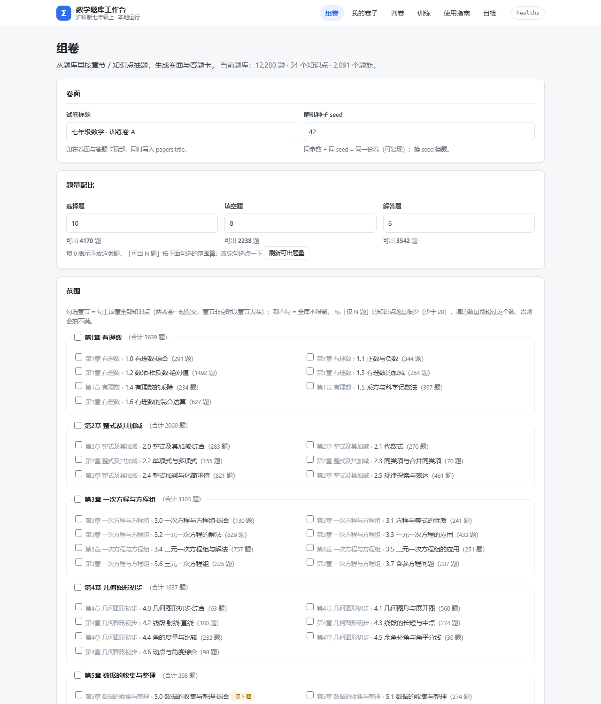 |
| 我的卷子（每行显示判卷次数、删除策略） | 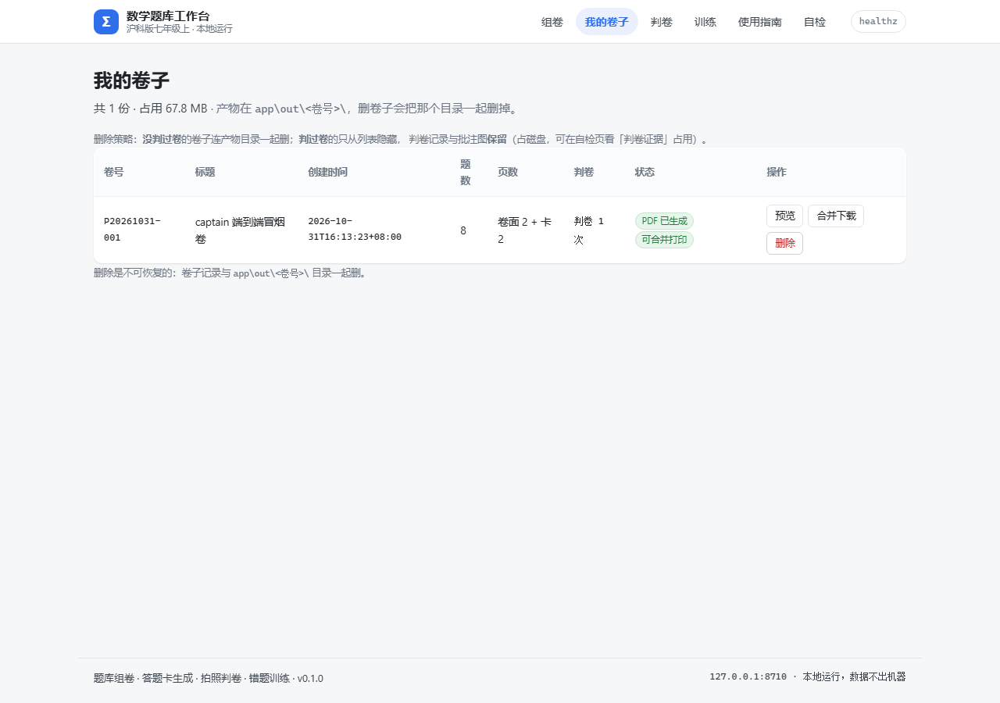 |
| 卷子预览（打印须知 + 卷面/答题卡预览 + 题目清单 + 参数） | 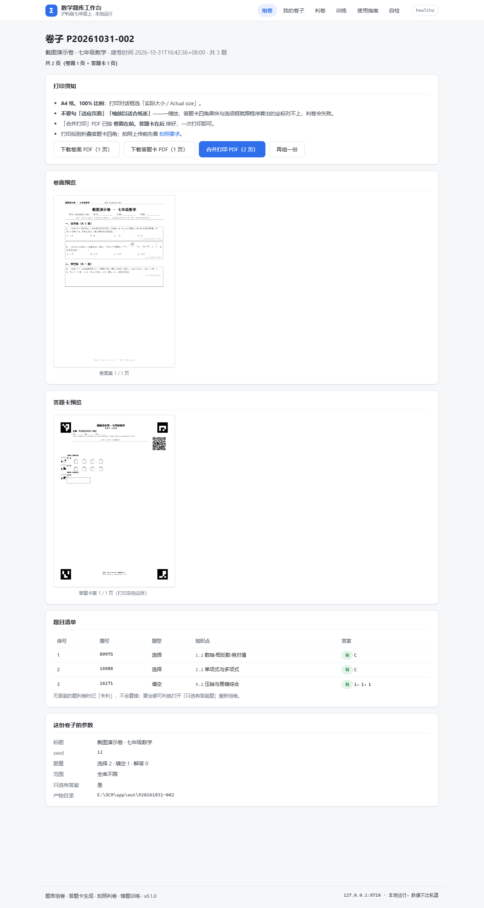 |
| 合并打印件（卷面第 1 页 / 答题卡页，看页脚与页码） | 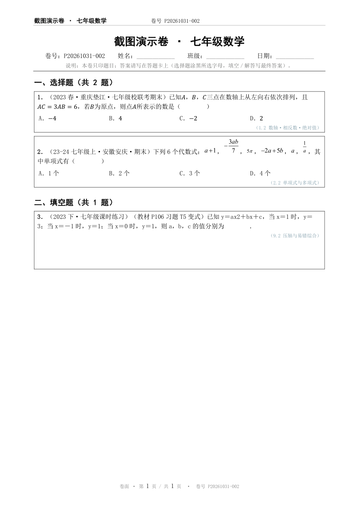 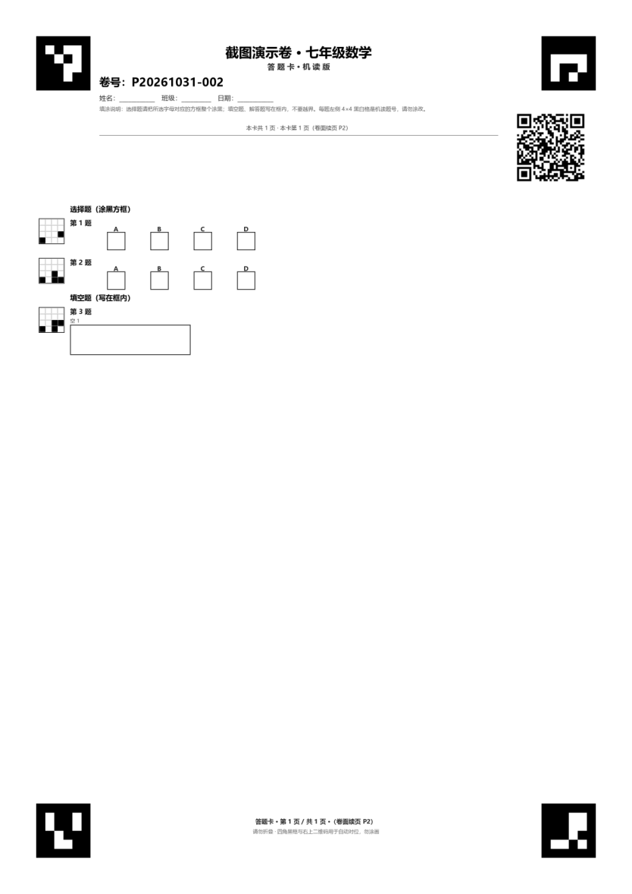 |
| 首页「尚未配置识别服务」提示（manual 后端） | 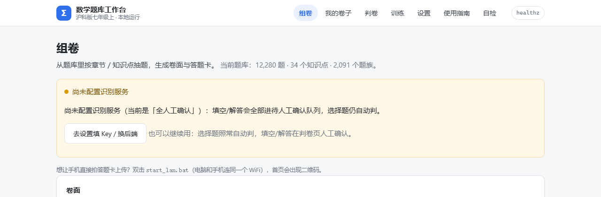 |
| 设置页（换后端 / 填 Key / 测试连接 / PDF 后端 / 当前路径） | 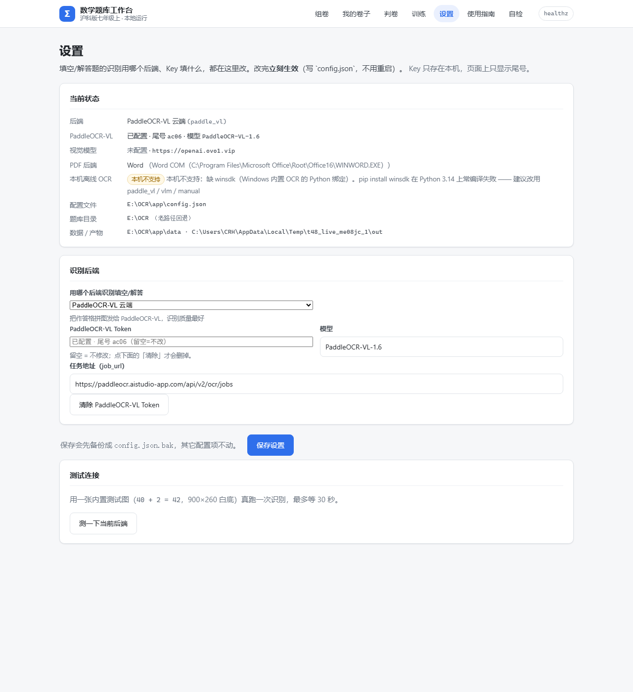 |
| 换一套题（预览页「同参数换一套」+ 显示本次随机种子） | 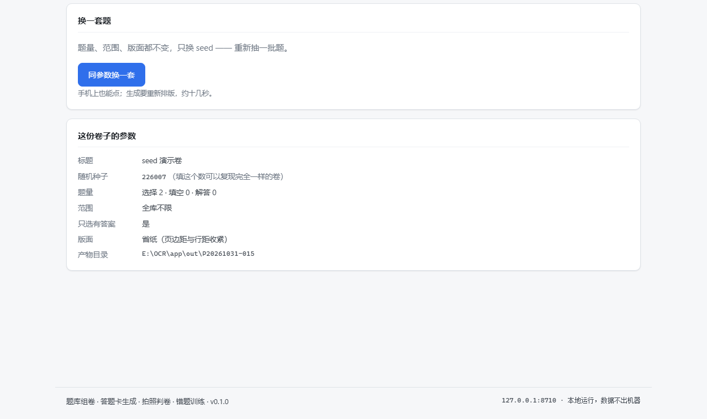 |
| 手机扫码入口（局域网模式：二维码 + 局域网地址 + 访问码提示） | 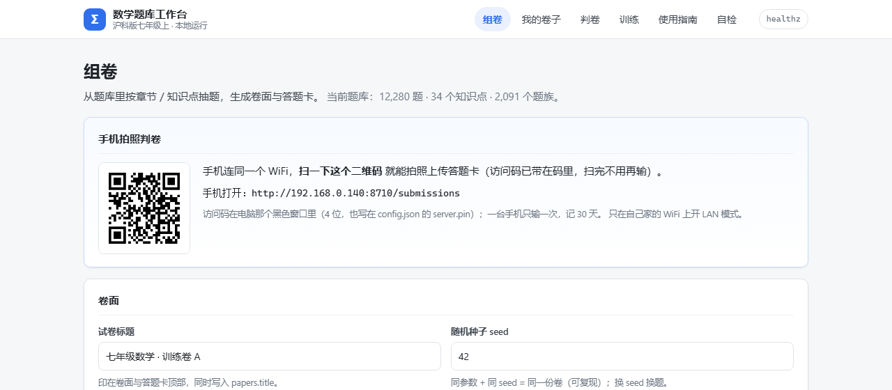 |
| 省纸模式（组卷表单复选框 + 更密的版面预览） | 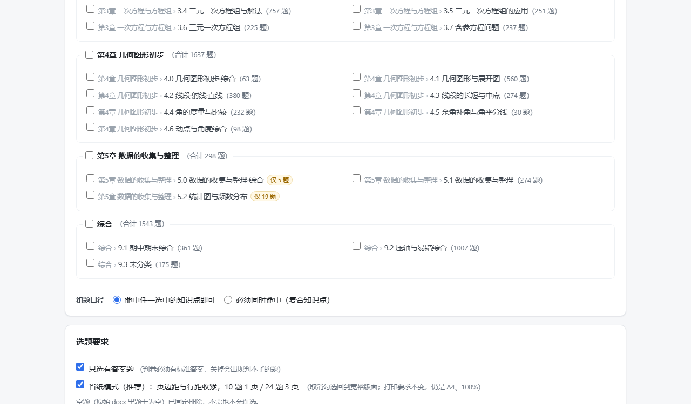 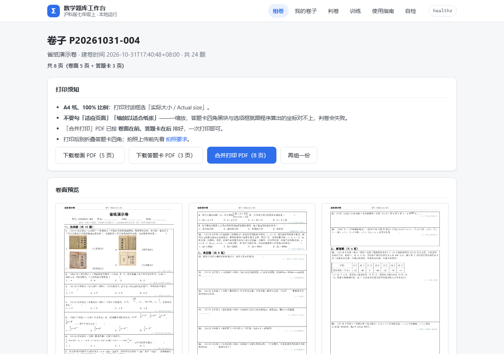 |
| 判卷结果（分数卡 + 逐题判定 + 待确认 + 训练入口） | 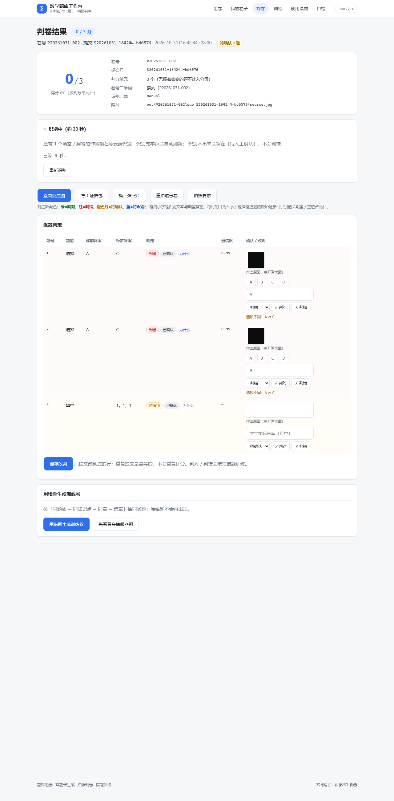 |
| 训练卷（错题抽同类题，原题不重复） | 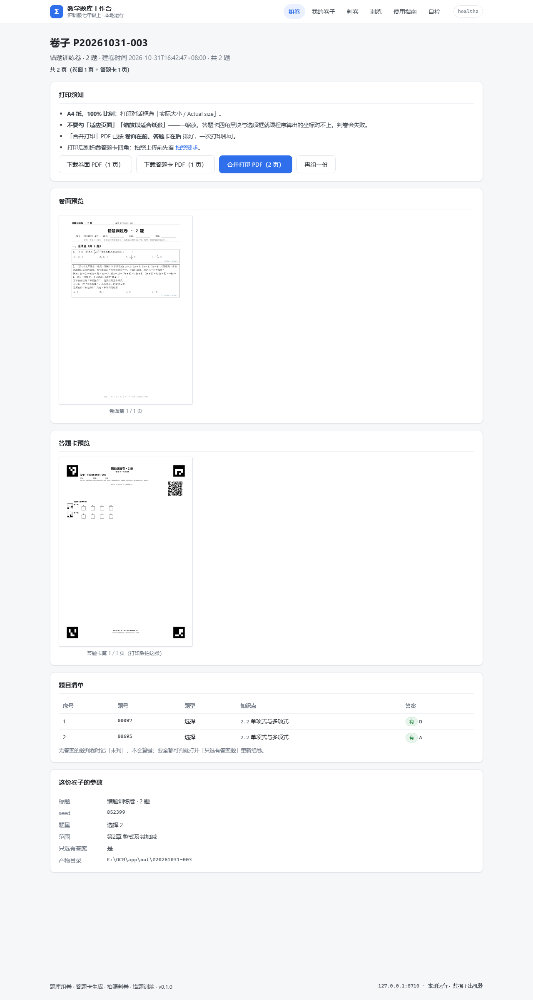 |
| 使用指南（打印 / 拍照 / 流程 / 错误速查） | 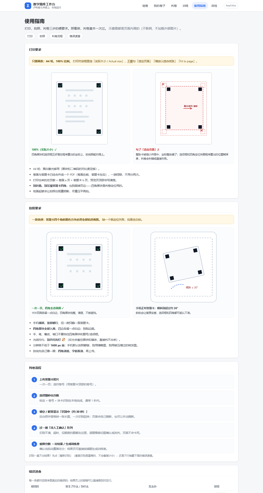 |
| 自检页（题库、Word、OCR、产物占用、判卷证据） | 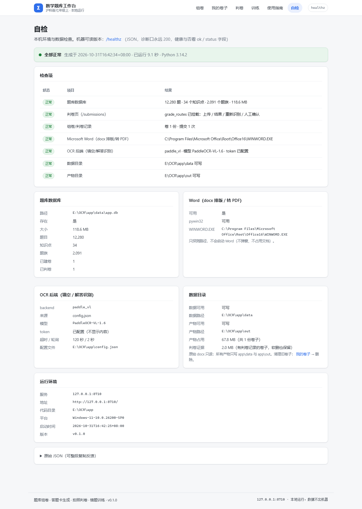 |

降级长什么样（Word 缺失 / 数据库缺失）见 [`docs/DEGRADED.md`](docs/DEGRADED.md)。

## 判卷怎么用

1. 上传答题卡照片 → **立刻**出选择题分数（毫秒级）。
2. 填空题 / 解答题显示「识别中（约 30 秒）」：后台把这张卡的作答格拼成一张长图，
   一次 OCR 全部识别回来。刷新页面或等它自动轮询即可。
3. 识别不清、超时、额度用完的题会进**待人工确认**队列，页面不会卡死。
4. 在待确认里逐题看裁切图，填正确答案或点「判对 / 判错」，确认完出总分。
5. 结果页顶部是**分数卡**（得分 / 满分 / 判分单元），标注「待确认 N 题」；逐题表里
   「为什么」能看识别证据（识别值 / 期望 / 墨迹占比），「导出证据包」把这套证据打成 zip。
6. 结果明细落库，可以据此生成训练卷。

判分只比较**最终答案**，比较前会做等价归一（例如 `1/2` 与 `0.5`、`x=4` 与 `4`、全角半角）。

## 训练卷怎么用

判卷结果页 → 底部「用错题生成训练卷」：按「同题族 → 同知识点 → 同章 → 跨章」四级回退抽同类题
（默认每道错题抽 3 道，可在 `/train` 页改 1–10），组成一份新卷（同样带答题卡），**原错题不会再出现**。
也可以打开 `/train` 手动贴题号生成。流程和普通组卷一样：预览 → 打印 → 拍照 → 判卷，形成闭环。

## 常见问题

页面上的每个错误都会给一个**错误码**（右上角灰底小字），点「使用指南 · 错误速查」能跳到
`/guide#err-<错误码>` 看三步处理法。常见码：

| 错误码 | 现象 | 怎么办 |
|---|---|---|
| `db_missing` | 首页 503「找不到题库数据库」 | 还没建库：`python E:\OCR\app\build_db.py`；或环境变量 `MATH_APP_DB` 指错了 |
| `db_locked` | 页面 503「数据库被占用」 | 另一个程序（Navicat / 另一个窗口）占着库，关掉后刷新 |
| `WordUnavailable` | 预览页横幅「卷面 PDF 未生成（本机未检测到 Word）」 | 没装 Word 或版本太旧：装 Word 2016+；答题卡仍可打印，`/health` 里能看到 Word 是否被检测到 |
| `warp_failed` | 判卷「标定失败 / 四角找不到」 | 四角黑块没拍全、被手挡、反光、倾斜过大 → 按「拍照要求」重拍（错误页会写「只检出 2/4 个 ArUco」） |
| `qr_failed` | 「卷号二维码解不出」 | 页边被裁、二维码污损 → 按页面提示手动填写卷号，判卷继续 |
| `pid_mismatch` | 「照片和卷子对不上」 | 上传的是另一份卷子的答题卡：核对卷号后重传 |
| `no_card` | 「这份卷子没有答题卡」 | 这份卷是 Word 缺失时出的旧卷，重新生成一份 |
| `InsufficientQuestions` | 组卷页「题量不够」 | 按错误里的「要 N 题 / 可用 M 题 / 差 K 题」把数量改小，或放宽章节/知识点 |
| `ScopeError` | 「范围对不上」 | 勾的章节/知识点在库里不存在，错误里会列出可选项 |
| `empty_batch` | 判卷「识别服务暂时无响应」 | 云端 OCR 整批空返回；点「重新识别」（幂等）或改用人工确认 |
| `ocr_timeout` / `ocr_quota` | 待确认队列变长 | 待人工确认照常可用；也可以把 `config.json` 的 `ocr.backend` 改成 `manual`，全人工确认 |
| `paper_not_found` / `submission_not_found` | 打开旧链接 404 | 卷子/判卷记录确实不在了（可能删过卷），回列表重新选 |
| `internal_error` | 兜底 500 页 | 页面会带原始报错，把这段反馈即可；不影响已生成的卷子 |

其它：

| 现象 | 怎么办 |
|---|---|
| 端口 8710 被占用 | 关掉旧的黑色窗口；或改 `start.bat` 的端口并同步 `config.json` |
| 判分和预期不一致 | 先看答案是否等价（如 `1/2` vs `0.5`）；确认无误就在待确认队列里人工改判 |
| 想重建数据库 | 删掉 `app\data\app.db` 后执行 `python E:\OCR\app\build_db.py`（约 20 秒） |

## 数据与隐私

- **全部本机运行**：服务只监听 `127.0.0.1:8710`，同一局域网的其它设备也访问不到。
- **原始题库只读**：`E:\OCR\*.docx`、`dedup`、`packages` 程序都不会修改、移动、删除。
- 上传的答题卡照片与判卷裁切图存在 `app\out\<卷号>\`，数据库在 `app\data\app.db`，随时可删。
- **唯一的上网行为**是 OCR 阶段：把「作答格拼成的长图」发给 PaddleOCR-VL 云服务识别；
  不想上云就把 `config.json` 的 `ocr.backend` 改成 `manual` —— 填空/解答全部人工确认，一样能判。
- OCR token 只存在本机 `app\config.json`，不会显示在页面上（自检页只报「已配置」），不要外发；
  对外分享配置请用脱敏的 `config.example.json`。

## 目录说明

```
app\
  start.bat            双击启动（找 Python / 查依赖 / 探 Word / 起服务 / 开浏览器）
  start_lan.bat        双击 = 局域网模式（同一 WiFi 的手机可访问，带 4 位访问码）
  server.py            Web 服务（组卷、预览、下载、判卷、训练）
  templates\ static\   界面（jinja2 + 原生 JS，无前端框架）
  picker.py            组卷选题       paper.py   卷面排版
  card.py              答题卡生成     grade.py   判卷流水线
  ocr.py               识别适配层     normalize.py 答案归一化
  train.py             错题训练规划   build_db.py  建库
  qbank\               题库（原始 *.docx；也可用 config.paths.qbank 指到别处）
  paths.py             路径解析（qbank / data / out，去硬编码）
  settings.html        设置页（模板，在 templates\ 下）
  data\                app.db、构建报告
  out\                 卷子 PDF/PNG、答题卡、判卷裁切图
  tests\               unittest（python -m unittest discover -s app\tests）
  docs\                界面截图、降级实测记录、截图重放脚本 capture.py
```

## 当前完成度

- 已完成：建库（22,898 → 12,280 有答案题）、知识点体系、题族、质量体检与过滤、组卷选题、卷面排版与保真闸门、
  答题卡生成（ArUco + QR）、答案归一化、识别适配层、判卷流水线（两阶段）、Web 全链路（组卷/预览/下载/打印合并/上传判卷/
  待人工确认/训练卷）、软删与数据清理、打包文档与本验收报告。
- 已知限制：见 `VERIFY.md` §10（语料「如图无图」2,932 题；真实手写识别率待验证）。

## 非 Windows 平台（macOS / Linux）

- **能做什么**：组卷选题、卷面排版、答题卡生成、拍照判卷、训练卷、Web 界面全部可用。
- **PDF 怎么出**：Windows 上优先用 Microsoft Word（COM）；macOS/Linux（或 Windows 没装 Word）
  自动回退 **LibreOffice**（soffice --headless --convert-to pdf）。装法：
  - macOS：装 LibreOffice（dmg），soffice 默认在 /Applications/LibreOffice.app/Contents/MacOS/soffice
  - Linux：`apt install libreoffice` / `dnf install libreoffice`（soffice 在 PATH 里）
  - 自定义位置：设环境变量 LIBREOFFICE_PATH=/path/to/soffice
  - 两个都没有 → 报 WordUnavailable("no_backend")，提示装 Word 或 LibreOffice
- **如实说明差异**：LibreOffice 的字体回退、页脚域（第 X 页/共 Y 页）、表格边框粗细、公式基线
  可能与 Word 有**细微差异**；判卷坐标按 A4 的 595.28×841.89pt 写死，所以两种后端都会校验 A4，
  非 A4 会直接报 pdf_not_a4（打印会整体错位，必须先修页面尺寸）。
- **便携版 exe 只适用于 Windows**（PyInstaller onedir）；macOS/Linux 请用源码运行
  （python app/launcher.py 同样会自动探测后端）。
- 当前状态（本机实测）：本开发机**没装 LibreOffice**，回退链路用伪造 soffice 验证过
  （转换/落位/A4 校验/错误详情），**未在真实 LibreOffice 上验证**；Windows+Word 路径行为未变。
- **未实测提醒**：LibreOffice 回退只用伪造的 `soffice` 跑通过，**没有在真实 LibreOffice 上实测**（命令行/profile/stderr/A4 校验都有测试，但字体与页脚域的真实差异未验证），本机也没装 LO，所以不能写成「已验证」。
- **先自检**：装完 LibreOffice 先跑 `python -m render --check`（或 `--json`）确认探测结果再出卷——它只打印「Word / LibreOffice / 都没有」和实际路径，不动数据库、不写文件。

## 开发者备注（打包）

- **冻结环境丢 `select` 的坑**：`ocr.pin_stdlib_select()` 会把 `_internal` 临时移出 `sys.path` 再 `import select`；
  打包后 `select.pyd` 就在 `_internal` 里 → `ModuleNotFoundError: No module named 'select'`，
  表现为 **grade_routes 挂不上、判卷页全部 404**（源码版永远复现不了）。`launcher._install_frozen_stdlib_bridge()` 
  用 meta_path finder 把 select 钉住；以后再引入「运行时才 import 的 stdlib 模块」，记得同样处理 + 补 `--hidden-import`。
